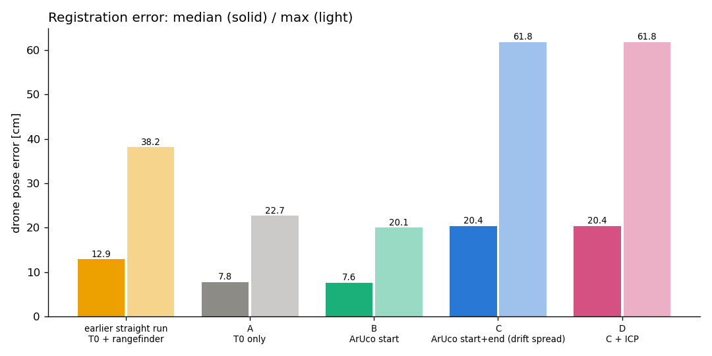
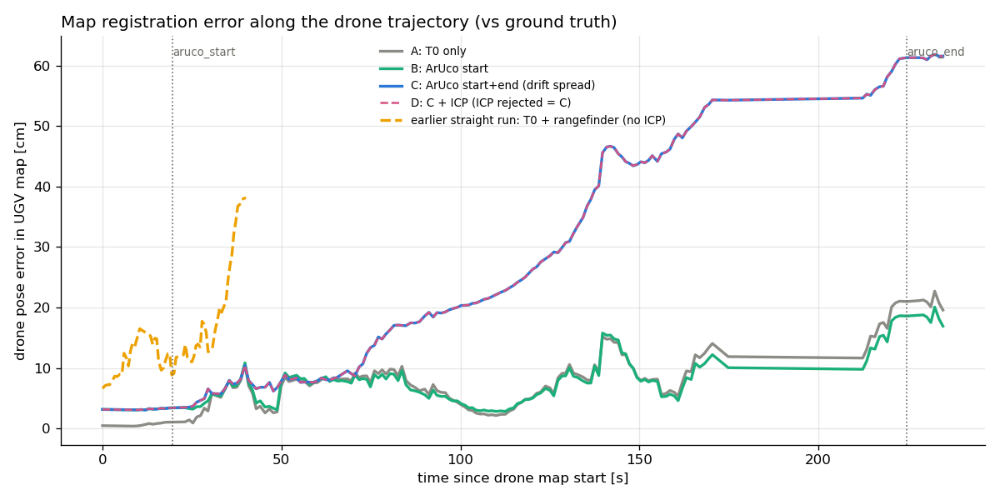

# UAV–UGV 협동 SLAM 시뮬레이션

드론(UAV)과 차량(UGV)이 함께 출발해 각자 RealSense D435로 RGB-D SLAM을 하고, 캐노피(지붕) 위·아래처럼
서로 못 보는 영역을 나눠 맵핑한 뒤 두 지도를 하나로 정합한다. 정답 포즈는 **채점에만** 쓰고, 정합에는
로봇에 실제로 있는 정보(착륙판 위치 T0, 거리센서, ArUco 마커, 점군)만 쓴다.

환경: Ubuntu 22.04, ROS 2 Humble, Gazebo Harmonic(gz sim 8), RTAB-Map(Humble 패키지).
상세 작업 기록(세션별 문제·해결): [`PROJECT_LOG.md`](PROJECT_LOG.md).

| 패키지 | 내용 |
|---|---|
| [`couv_sim_world`](src/couv_sim_world) | 월드 `canopy_world`: 20 × 20 m, 8 × 6 m 캐노피, 지붕 위/아래/공용 랜드마크, 반복 없는 텍스처 |
| [`couv_sim_robots`](src/couv_sim_robots) | 차량(4륜 스키드), 드론(S500 X-쿼드), D435 매크로, 브리지, 미션(일자 / ㄹ자+ArUco), 녹화 |
| [`couv_map_merge`](src/couv_map_merge) | 로봇별 RTAB-Map(bag 재생 / 실시간), ArUco 검출, 지도 정합·평가, RViz 재생 |

---

## 진행 상황 (2026-10-28 기준)

| 단계 | 내용 | 상태 |
|---|---|---|
| 1 | 월드 제작, 텍스처, 배치도 | ✅ 완료 |
| 2 | 로봇·센서·미션·녹화, 센서 검증 | ✅ 완료 |
| 3 | 일자 경로, 드론 카메라 90°, bag 재생 SLAM, T0/거리센서/ICP 정합 | ✅ 완료 |
| 4 | ㄹ자 경로, 드론 카메라 45°, 실시간 SLAM, ArUco 출발/도착, 착륙, 방식 1–4 비교(4 = RGB-D 특징점) | 🟡 실행·비교 완료, 착륙 미확인 |

### 남은 일
1. **공동 최적화(방식 5)**: 두 로봇 경로를 하나의 포즈 그래프로 묶어 두 지도를 함께 보정
   (오도메트리 + T0 + ArUco + RGB-D 특징점 + 차량 바닥 조건, 강건 커널, GTSAM/g2o).
   핵심은 **가중치 캘리브레이션**(로봇별 오도메트리 노이즈 a·거리 + b·회전, 측정 노이즈). 계획 상세: `PROJECT_LOG.md`.
2. 지도 점 ↔ 월드 실제 표면 거리 지표(`layout.py` 기하 사용).
3. 차량 VO 회전 드리프트 감소(바퀴 오도메트리 + IMU 융합), 절전 끄고 착륙까지 재실행.
4. 장기: 드론 VIO, PX4 SITL.

---

## 상황별 오차 비교

### SLAM 자체 정확도 (각 지도 원점 기준, 정답 대비)

| 실행 | 경로 | 드론 카메라 | 차량 지도 RMSE / 최대 | 드론 지도 RMSE / 최대 |
|---|---|---|---|---|
| 3단계 `couv_20261027_200102_pitch90` (bag 재생) | 일자 약 15 m, 56 s | 90° (하방) | **1.9 / 3.5 cm** | 13.6 / 35 cm (끝 y −27, z +22 cm) |
| 4단계 `serpentine_aruco` (실시간) | ㄹ자 약 61 m, 241 s | 45° | 27.0 / 62.0 cm | **9.3 / 22.2 cm** |

- 차량: 일자 경로에선 거의 완벽했지만 ㄹ자 경로의 **제자리 90° 회전**에서 크게 흐름(첫 회전 전후 11 → 22 cm,
  끝 59 cm, z도 +32 cm). 경로 길이 대비 약 1 %.
- 드론: 카메라 45°로 바꾸자 경로가 4배 길어졌는데도 오차가 줄어듦(벽·랜드마크 옆면이 보여 특징점이 많음).

### 정합 오차 (드론 지도를 차량 지도에 놓았을 때, 정답 대비)

3단계(지도 원점 하나의 변환 오차):

| 단계 | 오차 |
|---|---|
| 정합 없음(각자 원점) | 59.9 cm, 0.34° |
| T0(착륙판 오프셋)만 | 26.1 cm, 0.34° |
| **T0 + 거리센서 상승량 (채택)** | **6.6 cm, 0.34°** |
| ICP (rmse 1.9 cm) → 보정량 10.5 cm / 3.4°로 기각 | 13.6 cm, 3.2° |

4단계(드론 노드 전체의 위치 오차, `src/couv_map_merge/docs/serpentine/results.yaml`):

| 방법 | 중앙값 | 최대 | 시작 | 끝 | 각도 중앙값 |
|---|---|---|---|---|---|
| (참고) 3단계 일자, T0 + 거리센서, ICP 없음 — 같은 방식으로 채점 | 12.9 cm | 38.2 | 6.6 | 38.2 | 1.46° |
| A: T0만 | 7.8 cm | 22.7 | 0.5 | 19.6 | 0.58° |
| **B: ArUco 출발** | **7.6 cm** | **20.1** | 3.2 | 16.9 | 0.52° |
| C: ArUco 출발+도착(누적오차를 경로 길이로 분배) | 20.4 cm | 61.8 | 3.2 | 61.6 | 0.71° |
| D: C + ICP → 보정량 15.7 cm / 0.48°로 기각, = C | 20.4 cm | 61.8 | 3.2 | 61.6 | 0.71° |




### 번호별 방식 비교 (드론 노드 위치 오차, 오차율 = 오차 / 드론 이동 거리)

1 = 상대위치만(T0), 2 = 상대위치 + ICP, 3 = ArUco(출발+도착) + 상대위치 + ICP.
ICP는 기각 규칙(보정량 > 10 cm / 2°이면 버림)을 적용한 **채택** 결과와, 규칙 없이 **강제** 적용한 결과를 함께 적음.

| 단계 | 방식 | 중앙값 | 최대 | 끝 | 끝 오차율 | 비고 |
|---|---|---|---|---|---|---|
| 3단계 일자 (드론 19.5 m) | 1 T0만 | 22.2 cm | 30.2 | 25.9 | 1.33 % | |
| | 1 T0 + 거리센서 | 12.9 cm | 38.2 | 38.2 | 1.96 % | |
| | 2 + ICP (채택) | 12.9 cm | 38.2 | 38.2 | 1.96 % | ICP 10.5 cm / 3.43° → 기각 |
| | 2 + ICP (강제) | 13.7 cm | **24.2** | **13.1** | **0.67 %** | |
| | 3 | – | – | – | – | ArUco 없음 |
| 4단계 ㄹ자 (드론 73.5 m) | 1 T0만 | **7.8 cm** | **22.7** | **19.6** | **0.27 %** | |
| | 2 + ICP (채택) | 7.8 cm | 22.7 | 19.6 | 0.27 % | ICP 23.6 cm / 1.88° → 기각 |
| | 2 + ICP (강제) | 28.2 cm | 45.4 | 44.7 | 0.61 % | |
| | 3 (채택) | 20.4 cm | 61.8 | 61.6 | 0.84 % | ICP 15.7 cm / 0.48° → 기각 |
| | 3 (강제) | 16.9 cm | 60.0 | 59.8 | 0.81 % | |

- 3단계: 강제 ICP가 중앙값은 비슷하지만 끝 오차를 38 → 13 cm로 줄임(드론 지도가 휜 부분을 강체 변환으로 평균).
  지도 원점 하나만 보던 기존 채점(6.6 → 13.6 cm)과는 반대로 보임 → 무엇을 기준으로 채점하느냐에 따라 ICP 판단이 달라짐.
- 4단계: T0만 쓴 1번이 가장 좋음. ICP는 강제하면 1번을 크게 악화(7.8 → 28.2 cm), 3번은 약간 개선(20.4 → 16.9 cm)하지만
  3번은 차량 지도의 누적오차(끝 59 cm)를 따라가서 1번보다 나쁨.

### 방식 4: T0 + ArUco 도착 + RGB-D 특징점 (ICP 대신)

`feature_anchor.py`: 방식 3의 사전값으로 드론 노드 깊이점을 차량 카메라에 투영해 같은 곳을 본 노드 쌍을 고르고
(가림 검사 포함), 두 RGB 영상의 SIFT 특징을 매칭 → 깊이로 3D → RANSAC 강체 변환(인라이어 5 cm, 12개 이상)
→ 사전값에서 0.5 m / 8° 이내만 채택. 채택된 쌍마다 "그 노드에서의 드론 지도 → 차량 지도" 변환을 얻고,
출발 T0, 도착 ArUco와 함께 경로 길이 순으로 보간. 정답은 채점에만 사용.

- 후보 364쌍 → 채택 62 (매칭 부족 95, RANSAC 실패 198, 게이트 9) → 정리 후 기준점 10개.
- **매칭 자체는 정확**: 국소 정답 대비 위치 오차 중앙값 2.2 cm, 90 % 5.3 cm, 회전 0.30°, 인라이어 중앙값 20.
- **기준점 공백**: 경로 21.8–52.3 m(2줄, 캐노피)에는 없음 — 차량은 지붕 아래, 드론은 지붕 위를 보므로 공통 시야가
  없음(설계상). 매칭은 출발, 남쪽 줄 동쪽 끝, 북쪽 줄, 도착 근처에 몰림.

지표가 셋이라 함께 봐야 한다:
- **전역 오차**: 정답 대비(차량 지도 첫 노드 기준). 차량 지도 자체 누적오차(끝 59 cm)도 포함됨.
- **국소 오차**: 드론 노드가 *근처 차량 지도*에 대해 있어야 할 위치와의 차이(공간상 가장 가까운 차량 노드 기준,
  정답 사용). 합친 지도가 제대로 겹치는지를 나타내며 차량 지도 자체의 누적오차와 분리됨.
- **겹침 어긋남(빨강)**: 정답 없이 지도끼리만 비교. 드론 점 중 차량 점이 0.5 m 이내에 있는 점(겹침) 가운데
  차량 지도 표면까지 거리가 10 cm를 넘는 비율(평면에서는 점-평면 거리). ICP가 최소화하는 양과 같아 ICP에 유리.

| 방식 | 전역 중앙값 / 끝 | **국소 중앙값 / 최대 / 끝** | 겹침 어긋남(빨강) / 간격 중앙값 |
|---|---|---|---|
| 1 T0만 | **7.8** / 19.6 cm | 20.9 / 62.8 / 62.8 cm | 42 % / 7.1 cm |
| 2 T0 + ICP (강제) | 28.2 / 44.7 | 9.6 / 34.5 / 15.4 | **16 %** / **2.5** |
| 3 ArUco 출발+도착 + ICP (강제) | 16.9 / 59.8 | 11.6 / 25.0 / **3.3** | 19 % / 3.9 |
| **4 T0 + ArUco + RGB-D 특징점** | 20.6 / 61.6 | **7.7 / 18.4** / 3.9 | 22 % / 2.7 |

구간별 국소 오차(구간 끝, cm):

| 구간 | 1 | 2 | 3 | 4 |
|---|---|---|---|---|
| 출발 | **5.2** | 31.1 | 15.1 | **4.3** |
| 1줄 남쪽 | 18.7 | 8.3 | 10.7 | **6.1** |
| 회전 1 | 23.7 | 10.4 | **6.9** | 8.9 |
| 2줄 가운데 (캐노피, 기준점 없음) | 34.4 | **10.2** | 13.4 | 15.4 |
| 회전 2 | 52.0 | 13.1 | 25.0 | **6.2** |
| 3줄 북쪽 | 46.8 | 22.8 | 23.1 | **10.1** |
| 도착 | 62.8 | 15.4 | **3.3** | 3.9 |

해석:
- **"정답 대비 정확한 지도"와 "서로 잘 겹치는 지도"는 다른 목표**다. 1번은 전역 오차가 가장 작지만(시뮬에서 T0가 정확,
  드론 지도 드리프트만 남음) 차량 지도가 흐른 만큼 서로 어긋나 국소 오차가 가장 크다(끝 63 cm, 빨강 42 %).
- **4번이 국소 오차 최소**(중앙값 7.7 cm, 최대 18.4 cm): 중간 기준점이 있는 구간(남쪽 줄, 회전 2, 북쪽 줄)에서 2·3번보다
  2–3배 작다. 기준점이 없는 캐노피 구간(2줄)만 2번보다 나쁘다.
- 4번의 전역 오차가 3번과 같은 이유: 특징점도 "차량 지도"에 맞추는 상대 측정이라 차량 지도 누적오차를 고치지 못함.
- 빨강 비율은 ICP(2번)가 가장 낮지만, 이 지표는 ICP가 직접 최소화하는 값이고 겹침의 95 %가 바닥·벽이라
  평면 위 미끄러짐을 잡지 못한다. 정답 기반 국소 오차에서는 2번이 4번보다 25 % 크고 끝 오차는 4배.

RViz (`aruco_viz.launch.py`, 기본 `mode:=compare`): 1 | 2 | 3 | 4 패널, 주황 차량 / 파랑 드론, **빨강 = 겹침 어긋남 > 10 cm**,
노랑 구 = 특징점 매칭된 드론 노드(4번), 흰/회색 = 드론/차량 정답 경로.

### ㄹ자 비행 구간별 오차 (4단계, 각 구간 끝 시점, ICP는 강제 적용)

방식 1 = T0만, 2 = T0 + ICP, 3 = ArUco 출발+도착 + ICP. 오른쪽 두 열은 정합과 무관한 각 지도 자체의 누적오차
(각 지도 첫 노드 기준). 구간 중앙값·최대값은 `results.yaml`의 `segments_serpentine`.

| 구간 | 누적 비행 | 1 | 2 | 3 | 드론 지도 누적오차 | 차량 지도 누적오차 |
|---|---|---|---|---|---|---|
| 출발 (이륙, ArUco) | 6.5 m | **5.2 cm** | 31.1 | 15.1 | 5.3 | 0.2 |
| 1줄 남쪽 y=−6.5 | 22.7 m | **8.4** | 13.8 | 8.5 | 8.2 | 9.6 |
| 회전 1 (x=+8) | 29.3 m | **9.8** | 27.3 | 17.1 | 9.5 | 13.3 |
| 2줄 가운데 y=0 (캐노피 위) | 45.5 m | **7.0** | 31.2 | 19.8 | 7.3 | 21.5 |
| 회전 2 (x=−8) | 51.9 m | **15.2** | 40.5 | 34.1 | 15.1 | 24.6 |
| 3줄 북쪽 y=+6.5 | 65.8 m | **12.5** | 42.9 | 52.2 | 11.9 | 34.5 |
| 도착 (대기, ArUco, 착륙) | 72.7 m | **19.6** | 44.7 | 59.8 | 19.1 | 59.1 |

- **방식 1의 오차 = 드론 지도 자체의 누적오차** (모든 구간에서 0.6 cm 이내로 일치). 출발점이 정확하므로 남는 오차는
  드론 SLAM 드리프트뿐이다. 드론 드리프트는 회전 구간에서 늘고(9.5 → 15.1 cm) 직선 구간에서 일부 줄기도 한다.
- **방식 2는 출발부터 약 30 cm 어긋남**: ICP가 지도 전체를 한 번에 23.6 cm / 1.9° 옮겨 정확했던 출발점까지 틀어지고,
  이후 드론 드리프트가 더해져 44.7 cm까지 커짐.
- **방식 3은 차량 지도 누적오차를 따라감**: 출발 직후엔 15 cm, 1줄에선 방식 1과 비슷(8.5 cm)하지만, 차량 지도가
  회전마다 크게 흐르면서(13 → 25 → 59 cm) 함께 커져 도착에서 59.8 cm. 도착 ArUco 보정은 경로 길이 비율로
  나눠 적용하기 때문에 중간 구간(2줄, 3줄)에서도 차량 지도 쪽으로 끌려간다.
- 주의: 차량 지도 열은 **같은 시각**의 값이고 차량은 드론보다 늦다(드론이 3줄 끝 t=179 s일 때 차량은 3줄 시작,
  차량 도착 t=221 s). 차량 위치 기준으로 보면 차량 지도 누적오차는 남쪽 줄 끝(8, −6.5) 11.5 cm → 첫 회전 후 (8, 0)
  22.2 cm, 가운데 줄 끝(−8, 0) 25.8 cm → 두 번째 회전 후 (−8, 6.4) 34.0 cm, 북쪽 줄 (−1.6, 6.6) 35.7 cm → 도착
  (7.5, 6.5) 59.1 cm. 회전마다 약 8–10 cm씩 늘고, 마지막 북쪽 줄 동쪽 절반(약 9 m)에서 23 cm가 늘었다
  (이 구간 원인은 아직 미확인).

### ArUco 측정 정확도 (착륙판 ID 7, 0.30 m, 드론 카메라 45°)

| 시점 | 검출 | 마커 거리 | 차량→드론 상대 포즈 오차(중앙값) | 산포(카메라 y, z) |
|---|---|---|---|---|
| 출발(정지 차량 위 호버링) | 24회 / 4 s | 1.67 m | 3.9 cm | 49, 55 mm |
| 도착 | 23회 / 4 s | 1.59 m | 3.3 cm | 44, 57 mm |

예상(1–2 cm)보다 큼. 45° 비스듬한 시선에서 PnP의 깊이·기울기 방향이 불확실하다.

### 해석
- **T0 / 거리센서**: 시뮬에서는 드론이 정확히 T0에 스폰되므로 T0가 거의 정답(시작 0.5 cm). 3단계에서는
  드론 VO가 상승 후 시작해 그 높이를 거리센서로 보정해야 했다(26.1 → 6.6 cm).
- **ArUco 출발(B)**: 시뮬에서는 T0(0.5 cm)가 ArUco 1회 측정(3–4 cm)보다 정확해 A와 거의 같음.
  실제 로봇처럼 착륙 위치가 매번 다르면 B가 의미를 가진다.
- **ArUco 도착(C)이 오히려 악화된 이유**: C는 "차량 지도가 기준이고 드론 지도만 흐른다"고 가정한다.
  이번엔 차량 지도(끝 59 cm)가 드론 지도(끝 20 cm)보다 더 흘러, 드론 지도가 차량 지도의 오차를 그대로 따라갔다
  (C 끝 오차 61.6 cm ≈ 차량 지도 끝 오차). 도착 ArUco는 두 지도의 **상대** 누적오차만 알려 주고,
  어느 쪽이 흘렀는지는 모른다 → 방법 E(공동 포즈 그래프) 필요.
- **ICP**: 두 번 다 기각. 3단계는 겹치는 곳이 대부분 평평한 바닥이라 x·y·회전이 안 잡히고, 지도 끝의 휨을 맞추느라
  원점이 틀어짐. 4단계도 보정량이 T0 불확실성(10 cm / 2°)을 넘음. 기각 규칙은 정답 없이 동작한다.

---

## 겪은 문제와 해결 (요약)

| 문제 | 원인 | 해결 |
|---|---|---|
| Leo Rover 공식 시뮬레이터 사용 불가 | Humble 브랜치는 Fortress/Garden 전용 | 같은 크기 4륜 차량 직접 제작 |
| 원본 영상 녹화가 시뮬 1초당 130 MB | RGB-D 두 대 30 Hz | 압축 녹화, 4단계는 녹화 없이 실시간 SLAM |
| 드론 VO가 이륙 직후 시작 | 착륙판이 D435 근거리 한계(0.2 m)보다 가까움 | 거리센서 상승량으로 지도 원점 높이 보정 |
| ArUco 마커가 6 % 찌그러짐 | 착륙판 텍스처 비율 | `gen_pad_mesh.py` 수정 |
| 드론 위치 정상상태 오차 13 cm | 속도 제어만 사용 | 위치 제어에 적분항 추가 |
| 실시간 SLAM DB가 절반 시점에 2.2 GB | 노드 추가 기준이 벽시계, 깊이 32비트 | `DetectionRate 1`(시뮬 시간), 연결 안 된 노드 버림, 깊이 16비트 → 전체 157 MB |
| 차량이 (8, 0) 근처를 맴돌며 미션 실패 | 바퀴 마찰 mu1≠mu2인데 dartsim이 `fdir1` 무시 → 마찰 방향이 월드에 고정, heading ±90°에서 제자리 회전 0 | 바퀴 마찰 등방 0.6 (모든 heading에서 회전 확인) |
| 스크립트 종료가 멈추고 노드가 남음 | 비대화형 셸의 백그라운드 작업은 SIGINT 무시를 물려받음 | `run_live.sh`에 `set -m`, launch에 SIGTERM, 남은 프로세스 정리 |
| `pkill -f`가 자기 셸까지 종료 | 패턴이 자기 명령줄에도 포함 | PID로 직접 종료 |
| 4단계 실행이 착륙 직전에 멈춤 | 노트북 절전 → DDS/gz 통신 복구 안 됨 | 긴 실행 전 절전 끄기(지도는 착륙 직전까지 유효) |

---

## 실행

```bash
cd ~/ros2_ws && colcon build && source install/setup.bash

# 3단계: 녹화 bag -> 로봇별 SLAM -> 정합 + RViz 재생 (bag은 디스크 부족으로 삭제됨, 결과 폴더만 보관)
ros2 run couv_map_merge run_slam.sh ~/ros2_ws/bags/<bag>
ros2 launch couv_map_merge merge_viz.launch.py map_dir:=~/ros2_ws/maps/<bag>

# 4단계: 시뮬 + 실시간 SLAM + ㄹ자 ArUco 미션 (약 15분, 절전 끌 것)
ros2 run couv_map_merge run_live.sh ~/ros2_ws/maps/serpentine_aruco
ros2 run couv_map_merge watch_live.sh          # 실행 중 Gazebo GUI + RViz로 보기(선택)
ros2 run couv_map_merge compare_aruco.py --run ~/ros2_ws/maps/serpentine_aruco \
    --baseline ~/ros2_ws/maps/couv_20261027_200102_pitch90 --docs ~/ros2_ws/src/couv_map_merge/docs/serpentine
ros2 launch couv_map_merge aruco_viz.launch.py run:=~/ros2_ws/maps/serpentine_aruco   # RViz: 방식 1 | 2 | 3 나란히
ros2 launch couv_map_merge aruco_viz.launch.py mode:=cycle                           # RViz: A→B→C→D→정답 순환
```

## 데이터 위치

`maps/`는 용량 때문에 git에 넣지 않고 [Release `maps-20261028`](https://github.com/esjjj9178/uav-ugv-coop-slam/releases/tag/maps-20261028)에 올려 두었다.

```bash
cd ~/ros2_ws && gh release download maps-20261028 -R esjjj9178/uav-ugv-coop-slam && tar xzf maps.tar.gz
```

| 경로 | 내용 | 크기 |
|---|---|---|
| `maps/couv_20261027_200102_pitch90/` | 3단계 결과(ply, poses, `aux_bag`(정답·거리센서), `merge_result.yaml`). DB와 원본 bag은 삭제 | 24 MB |
| `maps/serpentine_aruco/` | 4단계 결과(DB, ply, poses, 노드별 rgb/depth/calib, `aux_bag`, ArUco 이미지, 로그) | 365 MB |
| `src/couv_map_merge/docs/` | 3단계 RViz 스크린샷, `serpentine/` 4단계 그림 01–05 + `results.yaml` | |
