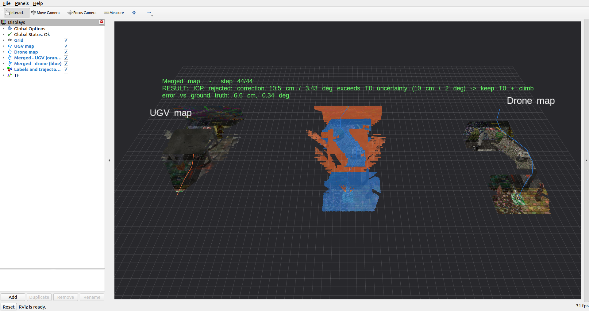
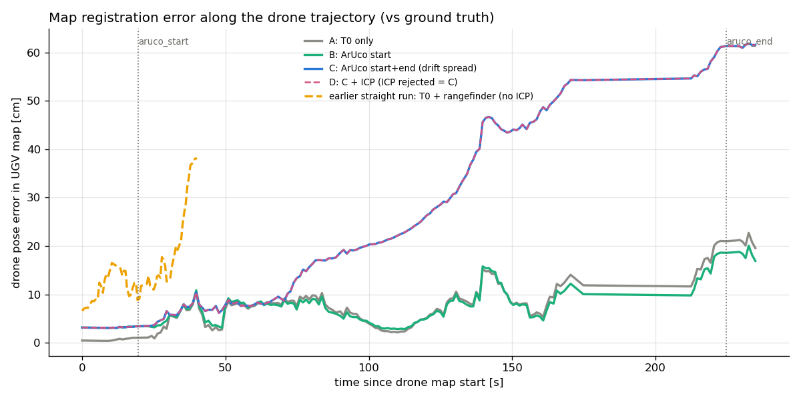

# couv_map_merge

Per-robot RTAB-Map maps from a [`couv_sim_robots`](../couv_sim_robots) bag, registration of the
drone map to the UGV map, and an RViz replay of every registration step.
Stage 3: straight run from a bag (below). Stage 4: serpentine run with live SLAM and ArUco ([section](#serpentine-run-with-aruco-mapsserpentine_aruco)).



Panels (fixed frame `merge_view`): **UGV map** (left, own colours) · **merged map** (middle, UGV orange,
drone blue, animated) · **drone map** (right, own colours). Lines are the SLAM trajectories.
The text shows the current step and its error against the ground truth.

## Run

```bash
cd ~/ros2_ws && colcon build --packages-select couv_map_merge && source install/setup.bash

# 1. one RTAB-Map database per robot (≈2.5 min for a 62 s bag), clouds + poses exported
ros2 run couv_map_merge run_slam.sh ~/ros2_ws/bags/couv_20261027_200102_pitch90
#    -> ~/ros2_ws/maps/couv_20261027_200102_pitch90/{ugv,drone}.db, *_cloud.ply, *_poses.txt, slam.log

# 2. registration + RViz replay (loops; ground truth/rangefinder are read from the bag of the same name)
ros2 launch couv_map_merge merge_viz.launch.py map_dir:=~/ros2_ws/maps/couv_20261027_200102_pitch90
#    -> merge_result.yaml in map_dir
```

Single maps in RTAB-Map's own viewer: `rtabmap-databaseViewer ~/ros2_ws/maps/<bag>/ugv.db`.

## Pipeline

1. **SLAM per robot** (`launch/slam_from_bag.launch.py`, `config/slam.yaml`): the compressed images
   in the bag are restored with `image_transport republish`, then `rgbd_odometry` + `rtabmap` run
   separately for each robot (`<robot>/map → <robot>/vo_odom → <robot>/base_link`). The bag's `/tf`
   (wheel odometry and ground truth) is not replayed. `robot_state_publisher` provides the sensor frames.
2. **Initial guess (onboard data only)**:
   - **T0** (`couv_sim_robots/config/frames.yaml` `landing_pad_offset`) is the pose of the drone on the pad.
   - The drone VO can start only after a short climb, because on the pad the camera is closer than
     the D435 near clip (0.2 m). The drone map origin is therefore above the pad, and the climb
     measured by the downward rangefinder is added to T0.z (`climb_correction: rangefinder`).
3. **ICP** (`couv_map_merge/registration.py`, `config/merge.yaml`):
   - point-to-plane, drone map to UGV map, with a T0 prior
   - roof points the UGV cannot see are removed
   - optional 4-DoF mode (gravity known) or source radius
4. **Acceptance**: ICP is adopted only if it moves the initial guess by less than the T0 uncertainty
   (10 cm / 2°). Otherwise the initial guess is kept. Ground truth is used only for reporting.

## Result: 90° bag (`couv_20261027_200102_pitch90`)

| step | error vs ground truth |
|---|---|
| maps in their own frames | 59.9 cm, 0.34° |
| T0 (pad offset) | 26.1 cm, 0.34° |
| **T0 + rangefinder climb (+0.243 m) — adopted** | **6.6 cm, 0.34°** |
| ICP (rmse 1.9 cm), rejected: moves 10.5 cm / 3.4° | 13.6 cm, 3.2° |

SLAM accuracy (ATE against the ground truth):
- UGV: 1.9 cm rmse, max 3.5 cm.
- Drone: 13.6 cm rmse, drift up to y −27 cm and z +22 cm at the end of the flight.

Why geometric ICP does not help here:
- **Drone map drift:** even with the *true* transform, the far end of the drone map (x > 10 m) is
  14.7 cm (median) away from the UGV map. 3/4 of the overlapping points lie there, so the rigid best
  fit moves the whole drone map and spoils the origin.
- **Overlap near the drone map origin is floor only:** the UGV camera looks forward and never sees
  landmarks A/B beside the start. Flat floor leaves x, y and yaw unobservable, and ICP limited to that
  region slides by metres.
- Every variant tried (6/4 DoF, source radius 4–8 m, balanced normals, T0 prior) ended worse than the
  initial guess. The acceptance rule catches this without ground truth.

The remaining 6.6 cm is mostly real x motion of the drone during take-off (+6.5 cm). It is not
observable from T0 and the rangefinder alone.

## Serpentine run with ArUco (`maps/serpentine_aruco`)

Drone camera 45°, serpentine path (-8, -6.5) → (8, 6.5) on three rows (y = -6.5, 0 under/over the canopy, 6.5),
ArUco marker (ID 7, 0.30 m) on the UGV pad photographed by the hovering drone at the start and at the goal.
SLAM runs **live** next to the simulation (no image recording); only a small log bag is kept.

```bash
ros2 run couv_map_merge run_live.sh ~/ros2_ws/maps/serpentine_aruco     # ≈15 min, disable suspend first
ros2 run couv_map_merge watch_live.sh                                   # optional: Gazebo GUI + RViz while running
ros2 run couv_map_merge compare_aruco.py --run ~/ros2_ws/maps/serpentine_aruco \
    --baseline ~/ros2_ws/maps/couv_20261027_200102_pitch90 --docs docs/serpentine
ros2 launch couv_map_merge aruco_viz.launch.py run:=~/ros2_ws/maps/serpentine_aruco   # RViz: methods 1 | 2 | 3 side by side
ros2 launch couv_map_merge aruco_viz.launch.py mode:=cycle                           # RViz: A → B → C → D → ground truth in turn
```

- `launch/slam_live.launch.py`: per-robot `rgbd_odometry` (`/<robot>/vo_odom`; `/ugv/odom` is the wheel odometry)
  + `rtabmap`, `aruco_detector.py`, and `aux_bag` (ground truth, rangefinder, mission state, marker poses, VO).
  `config/slam.yaml`: `Rtabmap/DetectionRate 1` (message stamps = sim time), `Mem/NotLinkedNodesKept false`,
  `Mem/SaveDepth16Format true` → both databases 157 MB for the whole run (instead of GBs).
- `run_live.sh` uses job control (`set -m`) so that background jobs keep SIGINT; launches are stopped with SIGTERM.
- Methods (drone map → UGV map), all from onboard data:
  **A** T0 only · **B** ArUco at the start · **C** ArUco start + end, the drift between them spread over the drone
  nodes by path length · **D** C + point-to-plane ICP with the same acceptance rule (10 cm / 2°).
- `aruco_viz.py`: the UGV map, the drone map, and in the middle the drone cloud placed by A → B → C → D →
  ground-truth placement (4 s each). C/D move every node differently, so the drone cloud is re-assembled from
  the exported node images per step. Thin white/grey lines are the drone/UGV ground truth in the UGV map;
  the gap between the orange UGV path and the grey line is the UGV map's own drift.

Result (run of 2026-10-28; landing not completed because the laptop suspended at t = 241 s, maps valid up to then):

| | |
|---|---|
| ArUco detections start / end | 24 / 23 in 4 s, marker 1.67 / 1.59 m away |
| UGV→drone relative pose from ArUco (median error) | 3.9 / 3.3 cm |
| SLAM ATE UGV (rmse / max) | 27.0 / 62.0 cm (1.9 / 3.5 cm on the straight run) |
| SLAM ATE drone (rmse / max) | 9.3 / 22.2 cm (13.6 / 35 cm on the straight run, camera 90°) |

| method | median | max | start | end |
|---|---|---|---|---|
| straight run, T0 + rangefinder, no ICP (same scoring) | 12.9 cm | 38.2 | 6.6 | 38.2 |
| A T0 only | 7.8 cm | 22.7 | 0.5 | 19.6 |
| **B ArUco start** | **7.6 cm** | **20.1** | 3.2 | 16.9 |
| C ArUco start + end | 20.4 cm | 61.8 | 3.2 | 61.6 |
| D C + ICP (correction 15.7 cm → rejected, = C) | 20.4 cm | 61.8 | 3.2 | 61.6 |



- A ≈ B: in simulation the drone spawns exactly at T0 (0.5 cm), better than one ArUco measurement (3–4 cm).
- **C is worse not because of a bug but because of its assumption** that the UGV map is the reference and only the
  drone map drifts. Here the UGV map drifted more (59 cm at the goal, mostly at the on-the-spot 90° turns) than the
  drone map (20 cm), so C pulled the drone map onto the UGV map's error (end 61.6 cm). The end measurement gives
  only the *relative* drift of the two maps, not which one drifted.
- Figures: `docs/serpentine/01_paths.png` … `05_aruco_end.png`, numbers in `docs/serpentine/results.yaml`.

## Next steps

- Method E: use the end ArUco as an inter-map loop closure in a joint pose graph and correct both
  maps by their uncertainty; also score local consistency in the overlap, not only the global error.
- Reduce the UGV VO drift at on-the-spot turns (lower yaw rate or wider turns), check RTAB-Map loop closures.
- Visual-inertial odometry for the drone (IMU in the bag) to reduce drift.
- Inter-robot loop closures in a joint pose graph instead of a single rigid transform. This handles
  drift; RTAB-Map multi-session: `rtabmap-reprocess "ugv.db;drone.db" merged.db`.

## Files

- `config/slam.yaml`: playback rate, RTAB-Map/odometry parameters, export settings
- `config/merge.yaml`: climb correction, ICP, acceptance, replay settings
- `launch/slam_from_bag.launch.py`, `couv_map_merge/run_slam.sh`: step 1
- `couv_map_merge/registration.py`: PLY/poses/bag I/O, ground truth, initial guess, ICP
- `couv_map_merge/merge_viz.py`, `launch/merge_viz.launch.py`, `rviz/merge.rviz`: registration and RViz replay
- `launch/slam_live.launch.py`, `couv_map_merge/run_live.sh`, `couv_map_merge/watch_live.sh`, `rviz/live.rviz`: live SLAM next to the simulation
- `couv_map_merge/aruco_detector.py`: pad marker pose from the drone camera, capture images
- `couv_map_merge/compare_aruco.py`: methods A–D and 1–4 (`solve()`), global / local / overlap scores, per-segment table, figures
- `couv_map_merge/feature_anchor.py`: method 4, RGB-D SIFT matches between the two maps → per-node anchors
- `couv_map_merge/aruco_viz.py`, `launch/aruco_viz.launch.py`, `rviz/aruco.rviz`: RViz replay of A–D
- `docs/merge_rviz_result.png`, `docs/merge_rviz_icp_step.png`, `docs/serpentine/`
