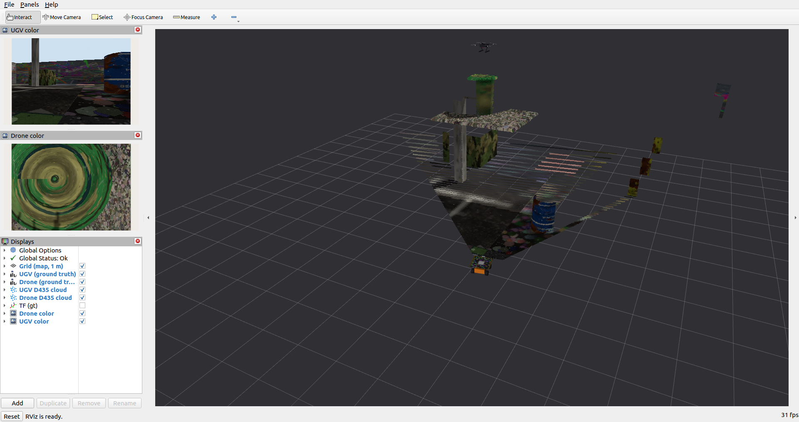
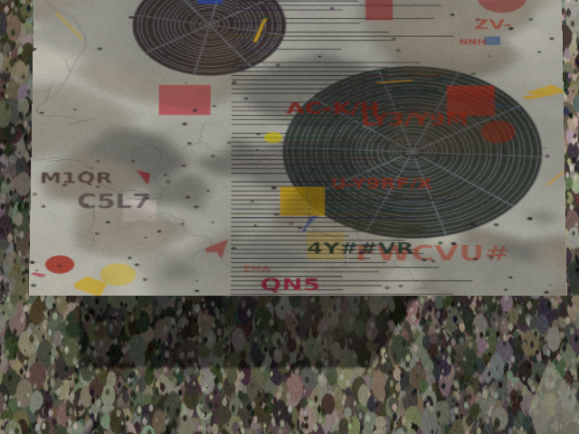
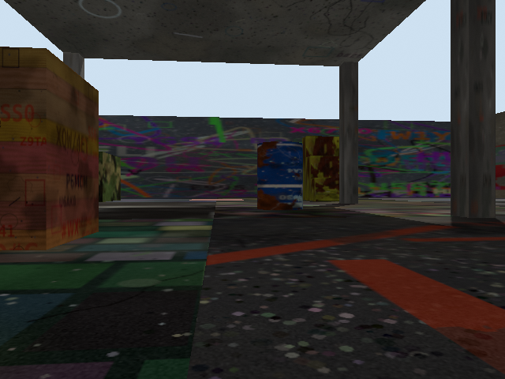
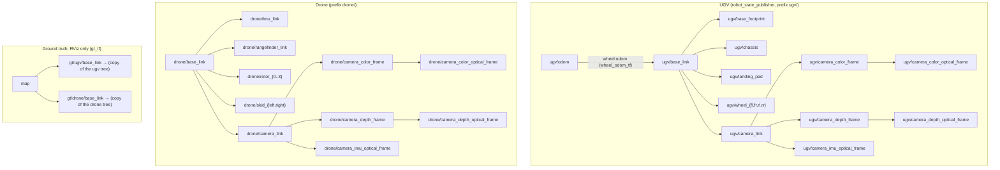

# couv_sim_robots

UGV + drone with simulated Intel RealSense D435 for the `canopy_world` of
[`couv_sim_world`](../couv_sim_world) (ROS 2 Humble, Gazebo Harmonic, `ros-humble-ros-gzharmonic`).
Scope: robots, sensors, ROS topics, a repeatable test mission and recording.
SLAM and map merging are the next stage.

| RViz: both D435 clouds in `map` (drone 90°) | drone D435, 90° (AC unit from above) | UGV D435 (under the roof) |
|---|---|---|
|  |  |  |

Drone camera at 45°: [`docs/rviz_both_clouds_pitch45.png`](docs/rviz_both_clouds_pitch45.png),
[`docs/drone_color_pitch45.png`](docs/drone_color_pitch45.png).

## Robots

**UGV**: Leo Rover sized 4-wheel skid steer (0.43 × 0.43 × 0.25 m), `gz-sim-diff-drive-system`,
textured 0.5 × 0.5 m landing pad on top with an ArUco marker (`DICT_4X4_50` ID 7, 0.30 m, `ugv.aruco` in
frames.yaml, texture from `gen_pad_mesh.py`), front D435 at 0.30 m height.
Wheel friction is isotropic (μ = 0.6): with μ1 ≠ μ2 the friction directions stay fixed in the world (dartsim ignores
`fdir1`), and the skid-steer UGV could not turn on the spot near headings of ±90°. Measured now: 0.35 rad/s commanded
→ 0.23 rad/s on the spot at every heading, 0.4 m/s straight.
The official Leo simulator was not used: `leo_simulator-ros2` `humble` supports Fortress/Garden only
(`leo_gz_plugins` builds against gz-sim 6/7), Harmonic support exists only on the `jazzy`/`ros2`
branches, and there are no Humble apt packages.

**Drone**: S500 class X-quad (0.5 m motor diagonal, 1.5 kg), Gazebo built-in
`MulticopterMotorModel` ×4 + `MulticopterVelocityControl` (velocity commands on `/drone/cmd_vel`).
Sensors: D435iF under the body (pitch `drone_cam_pitch_deg`, default 90 = down), IMU 200 Hz,
barometer (`air_pressure` + `gz-sim-air-pressure-system`, loaded by the drone model), 1-beam
downward `gpu_lidar` (10 m).
The flight controller block is isolated in `urdf/drone_drive_mc_velocity.xacro`; for PX4 SITL replace
only that macro (airframe, sensors, frames, topics stay).

**D435 macro** (`urdf/d435.xacro`, shared): `rgbd_camera` 640 × 480 @ 30 Hz, HFOV 69.4°
(1.211 rad), depth 0.2–10 m with gaussian noise σ = 0.01 m (colour image not range limited),
internal IMU 200 Hz, realsense frame names. The simulated depth is registered to the colour image
(same optical frame), `32FC1` in metres.

All numbers (sizes, mounts, rates, gains, spawn, T0) are in **`config/frames.yaml`**; the xacro files read
it, and `sim.launch.py` computes the spawn poses from it.

## Build & run

```bash
cd ~/ros2_ws && colcon build --packages-select couv_sim_world couv_sim_robots && source install/setup.bash

ros2 launch couv_sim_robots sim.launch.py                         # world + robots + bridge + RViz + Gazebo GUI
ros2 launch couv_sim_robots sim.launch.py drone_cam_pitch_deg:=45 # forward-down drone camera
ros2 run couv_sim_robots mission_runner.py --ros-args -p use_sim_time:=true   # test mission
ros2 run couv_sim_robots record.sh --until-complete                # in another terminal, before the mission
```

Typical data-collection run (three terminals): `sim.launch.py gui:=false` → `record.sh --until-complete`
→ `mission_runner.py`. The recorder stops by itself when `/mission/state` becomes `complete`.

| launch argument | default | meaning |
|---|---|---|
| `drone_cam_pitch_deg` | frames.yaml (90) | drone D435 pitch; 90 = straight down, 45 = forward-down, 0 = forward |
| `ugv_cam_height` | frames.yaml (0.30) | UGV D435 optical centre above the ground [m] |
| `depth_noise_stddev` | frames.yaml (0.01) | gaussian depth noise of both D435 [m] |
| `gui` | true | Gazebo GUI (server only when false) |
| `rviz` | true | RViz with `rviz/sim.rviz` |
| `gt_tf` | true | ground truth as the separate `map → gt/<robot>/…` TF tree + `/viz/<robot>/points` for RViz |
| `wheel_odom_tf` | true | bridge the diff-drive TF `ugv/odom → ugv/base_link` |
| `pointcloud` | true | `…/camera/depth/color/points` via `depth_image_proc` |
| `compress` | true | JPEG / compressedDepth image streams (recorded by `record.sh`) |
| `ugv_spawn_x`, `ugv_spawn_y`, `ugv_spawn_yaw` | frames.yaml | UGV start pose in map; the drone follows via T0 |
| `mission` | false | start `mission_runner.py` from the launch file |
| `frames_yaml`, `mission_yaml` | `config/…` | alternative configuration files |

The Gazebo simulation runs at a real-time factor of ≈ 0.5 on this laptop (two RGB-D cameras on the
integrated GPU). Everything uses `use_sim_time`, so rates below are in simulation time.

## Coordinates and T0

- `map` = Gazebo world origin of `canopy_world` (map centre), z up (REP-103/105).
  The UGV starts with `ugv/base_footprint` at **map (-7, 0, 0)**, facing +x;
  `ugv/base_link` is on the axle line, i.e. at map (-7, 0, 0.0625).
- All frames carry the robot prefix (`ugv/…`, `drone/…`); `robot_state_publisher` runs once per
  robot with `frame_prefix`.
- **T0 = `landing_pad_offset` in `config/frames.yaml`** = pose of `drone/base_link` in `ugv/base_link`
  while the drone sits on the pad: **x 0, y 0, z 0.3425 m, yaw 0**
  (pad top 0.1875 m above `ugv/base_link` + drone base_link 0.15 m above its skids + 0.005 m spawn gap;
  the drone settles 5 mm lower, measured z = 0.400 m in map).
  The drone spawn pose is computed from it, and it is the initial guess for registering the
  drone map to the UGV map (both robots start their SLAM at this relative pose).
  `sim.launch.py` warns if T0.z does not match the pad / skid geometry.

## Topics

Rates measured from the recorded bag (`couv_…_pitch90`, 62.3 s simulated).

| topic | type | rate (sim) |
|---|---|---|
| `/clock` | rosgraph_msgs/Clock | 1000 Hz |
| `/{ugv,drone}/camera/color/image_raw` | sensor_msgs/Image (rgb8) | 30 Hz |
| `/{ugv,drone}/camera/color/camera_info`, `…/depth/camera_info` | sensor_msgs/CameraInfo | 30 Hz |
| `/{ugv,drone}/camera/depth/image_rect_raw` | sensor_msgs/Image (32FC1, m) | 30 Hz |
| `/{ugv,drone}/camera/depth/color/points` | sensor_msgs/PointCloud2 (xyz+rgb, optical frame) | 30 Hz¹ |
| `/{ugv,drone}/camera/color/image_raw/compressed` | sensor_msgs/CompressedImage (JPEG 95) | 30 Hz |
| `/{ugv,drone}/camera/depth/image_rect_raw/compressedDepth` | sensor_msgs/CompressedImage (PNG) | 30 Hz |
| `/{ugv,drone}/camera/imu` | sensor_msgs/Imu (D435i/iF IMU, optical frame) | 200 Hz |
| `/{ugv,drone}/ground_truth/odom` | nav_msgs/Odometry (`map` → `<robot>/base_link`, topic only) | 50 Hz |
| `/{ugv,drone}/joint_states` | sensor_msgs/JointState | 50 Hz |
| `/ugv/cmd_vel` | geometry_msgs/Twist (in) | – |
| `/ugv/odom` | nav_msgs/Odometry (wheel odometry, `ugv/odom` → `ugv/base_link`) | 50 Hz |
| `/drone/cmd_vel` | geometry_msgs/Twist (in, body frame) | – |
| `/drone/enable` | std_msgs/Bool (in, velocity controller on/off) | – |
| `/drone/imu` | sensor_msgs/Imu (`drone/imu_link`) | 200 Hz |
| `/drone/air_pressure` | sensor_msgs/FluidPressure | 50 Hz |
| `/drone/rangefinder` | sensor_msgs/LaserScan, 1 beam, `ranges[0]` = distance below | 20 Hz |
| `/mission/state` | std_msgs/String (transient local) | on change |
| `/viz/{ugv,drone}/points` | PointCloud2 relabelled into the `gt/` tree for RViz | 2 Hz |

¹ produced by `depth_image_proc` from depth + colour. Gazebo's own rgbd cloud is not bridged:
it uses x-forward axes while carrying the optical frame id.

Depth check (`ros2 run couv_sim_robots check_depth.py`, UGV at the start, centre image row ray-cast
against `couv_sim_world/scripts/layout.py`): crate stack 4.880 m expected / 4.882 m measured,
pillars 6.630 / 6.633 and 6.630 / 6.631 m, drum 8.274 / 8.273 m; median error +0.8 mm, σ 1.4 cm.

### Rangefinder over the roof

`/drone/rangefinder` measures the distance to whatever is directly below. At 5 m it reads ≈ 4.96 m over
the floor, jumps to ≈ 1.76 m when the drone crosses the roof edge (roof top z = 3.2), and to
≈ 0.96 m / 0.76 m over the AC unit / water tank (recorded range during the mission: 0.73–4.99 m).
These steps are correct (the terrain changes, not the altitude). Use the barometer / IMU or the
ground truth for altitude, not the rangefinder.

## Frames



Full tree: [`docs/tf_tree.pdf`](docs/tf_tree.pdf) (`ros2 run tf2_tools view_frames`).
Ground truth is never published as `map → ugv/…` or `map → drone/…`, so SLAM can own
`<robot>/map → <robot>/odom` (or `map → …`) later. With `gt_tf:=false` the `gt/` tree and `/viz/*` disappear.
The drone has no odometry frame yet (PX4 / VIO will provide `drone/odom` later).

## Test mission

`mission_runner.py` follows `config/mission.yaml` with the **ground-truth pose** (simulation only).

1. drone takes off vertically from the pad to 5.0 m (0.5 m/s) and hovers 3 s
2. UGV: (-7, 0) → (-4.5, 0) → (-1.5, -0.3) → (1.8, 0.4) → (4.5, 0) → (7, 0), max 0.4 m/s, yaw rate ≤ 0.35 rad/s
3. drone, started together with the UGV, at 5 m: (-4.5, -1.2) → **(-2, -1.2) above the AC unit** →
   (0, 0) → **(2, 1.2) above the water tank** → (4.5, 1.2) → (7, 0), max 0.8 m/s, accel ≤ 0.5 m/s², fixed yaw
4. both stop; the drone hovers over the goal; `/mission/state` = `complete`

Measured over two runs (90° and 45°): 55.9–56.1 s simulated from take-off to complete, identical waypoint times,
UGV final (6.86, -0.01), drone (7.13, 0.00, 5.00); UGV max 0.400 m/s; drone max 0.80 m/s, roll/pitch ≤ 3.1°,
body rates ≤ 0.15 rad/s, yaw rate 0.001 rad/s; no slip on the pad before take-off (0.00 mm);
UGV body-to-obstacle gap ≥ 0.79 m (crate stack 0.83 m, drum 0.79 m).
(Measured with the earlier anisotropic wheel friction μ1 1.0 / μ2 0.6; this straight route has no on-the-spot turns.)

### Serpentine mission with ArUco (stage 4)

`mission_aruco.py` follows `config/mission_serpentine.yaml` (ground-truth pose, simulation only). Start the simulation
with `ugv_spawn_x:=-8 ugv_spawn_y:=-6.5 ugv_spawn_yaw:=0 drone_cam_pitch_deg:=45`
(`couv_map_merge/run_live.sh` does this together with live SLAM).

States: `waiting → takeoff → move_to_aruco_start → aruco_start` (hover 1.2 m behind / 1.2 m above the pad for 4 s,
`couv_map_merge/aruco_detector.py` measures the marker) `→ climb → cruise` (5 m, 0.5 m/s, three rows
y = -6.5, 0, 6.5) `→ wait_ugv → approach → aruco_end → move_over_pad → land → complete`.
The UGV drives the same rows at ≤ 0.4 m/s (under the canopy on the middle row). The drone position controller has an
integral term (`ki`, active within 0.5 m) that removed a 13 cm steady-state error of the velocity controller.

Run of 2026-10-28: drone at the goal row end t = 179 s, UGV at the goal t = 221 s, `aruco_end` t = 233 s,
`land` t = 241 s (landing not completed: the laptop suspended; to be re-run).

## Recording

`record.sh` reads `config/recording.yaml` (topics, storage, output directory).
Raw RGB-D for both robots is ≈ 130 MB per simulated second, so the default profile records the
compressed image streams (colour JPEG q95, depth `compressedDepth` PNG; measured depth error after
decompression: median 1.2 mm, max 2.4 mm in 3.6–5 m) plus camera_info, IMUs, odometry, ground truth,
joint states, `/tf`, `/tf_static`, `/clock`, `/mission/state`.
Options: `--raw` (raw images), `--points` (clouds), `--pitch DEG`, `--out DIR`, `--until-complete`.
The bag name contains the date and the drone camera pitch (read from `/tf_static`):
`couv_<YYYYmmdd_HHMMSS>_pitch<DEG>`.

Storage is mcap (`zstd_fast`); if `ros-humble-rosbag2-storage-mcap` is not installed the script falls back
to sqlite3 with a warning.

**Bags used for stage 3** (deleted later for disk space; the stage-3 results are kept in
`~/ros2_ws/maps/couv_20261027_200102_pitch90` with a 5 MB `aux_bag` of ground truth and rangefinder):

| bag | drone camera | size | duration (sim) |
|---|---|---|---|
| `couv_20261027_200102_pitch90` | 90° (down) | 1.4 GiB | 62.3 s |
| `couv_20261027_195721_pitch45` | 45° | 1.3 GiB | 62.5 s |

Both were recorded with sqlite3 storage (mcap plugin not installed at that time).
For RTAB-Map use image_transport `compressed` / `compressedDepth`, or restore raw topics during playback:
`ros2 run image_transport republish compressed raw --ros-args -r in/compressed:=/ugv/camera/color/image_raw/compressed -r out:=/ugv/camera/color/image_raw`.

## Tools

- `check_depth.py`: depth image vs. world geometry (above)
- `topic_rates.py [seconds] [topics…]`: rates in simulation time + real-time factor
  (`ros2 topic hz` measures wall time, and Python subscribers drop large images; use bag counts for camera rates)
- `gt_viz.py`: ground-truth TF + throttled cloud relay for RViz (started by `gt_tf:=true`)
- `gen_pad_mesh.py`: regenerates `meshes/landing_pad.{obj,mtl,png}`

## Known messages

- At spawn, Gazebo prints 7 `Warning [Utils.cc:132] … gz_frame_id … not defined in SDF` lines
  (14 with the GUI). `gz_frame_id` is read by gz-sensors but is not yet in the sdformat 14 schema;
  the frame ids are applied correctly.
- On Ctrl-C, `image_transport/republish` and sometimes `parameter_bridge` exit with SIGSEGV, gz needs
  SIGTERM, and launch prints `Cannot shutdown a ROS adapter that is not running`. These happen only
  during shutdown (Humble image_transport / ros_gz); bags are closed before that.
- During a run, the launch log contains no other warnings or errors.
- Run one simulation at a time: two Gazebo instances in the same ROS domain publish two `/clock`s
  (RViz "jump back in time", robot_state_publisher "moved backwards in time").
