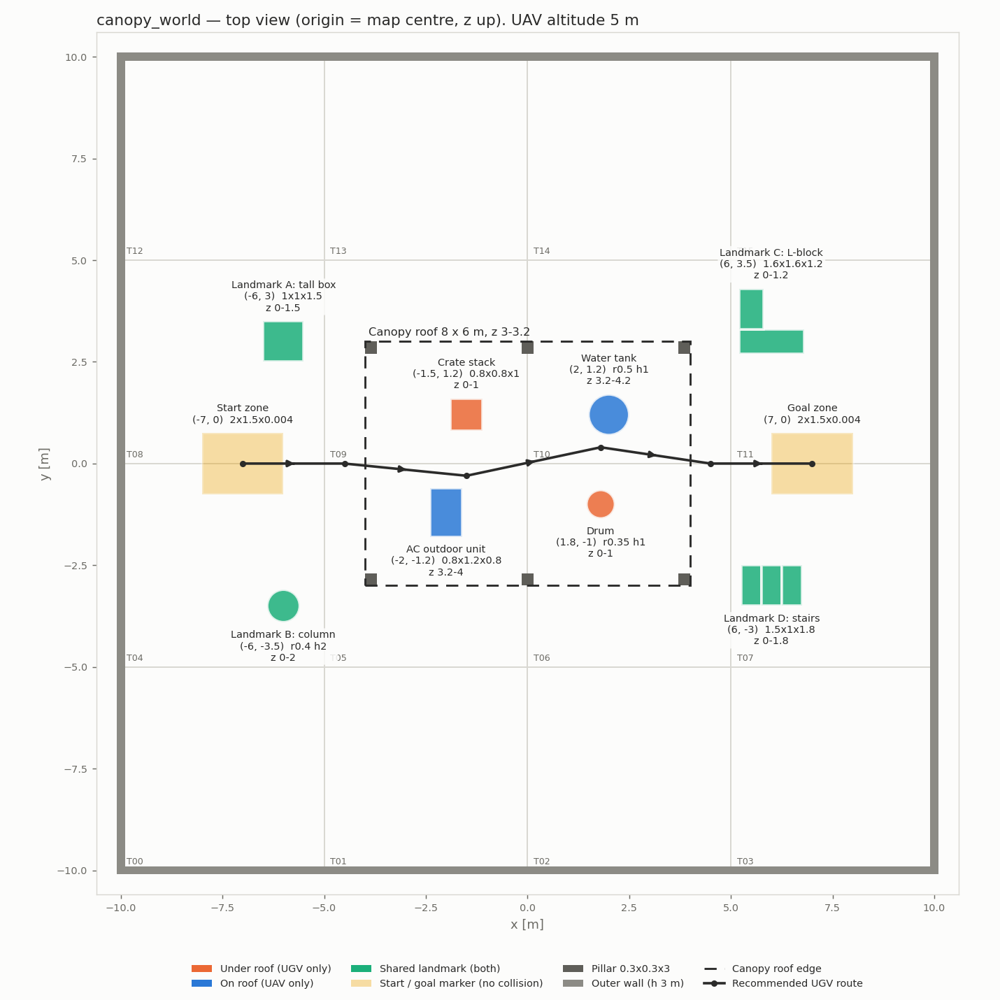
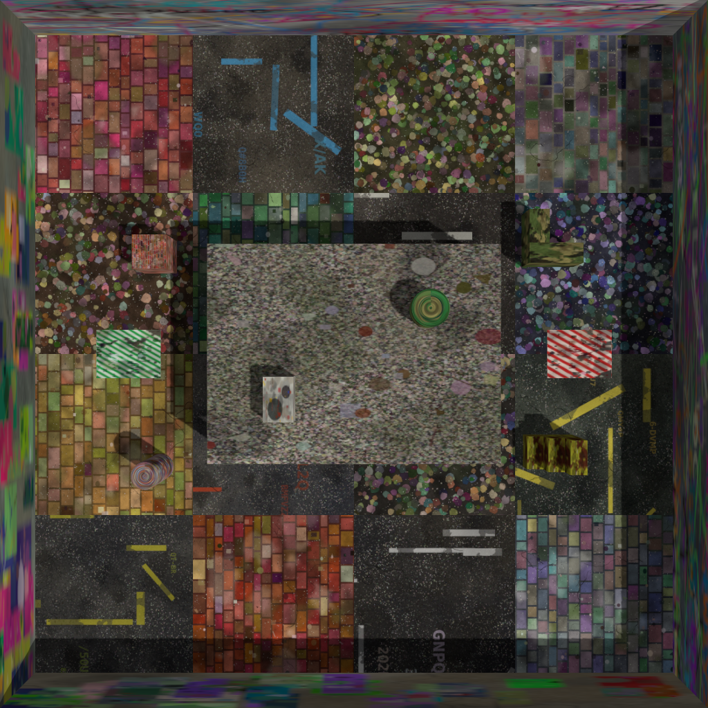
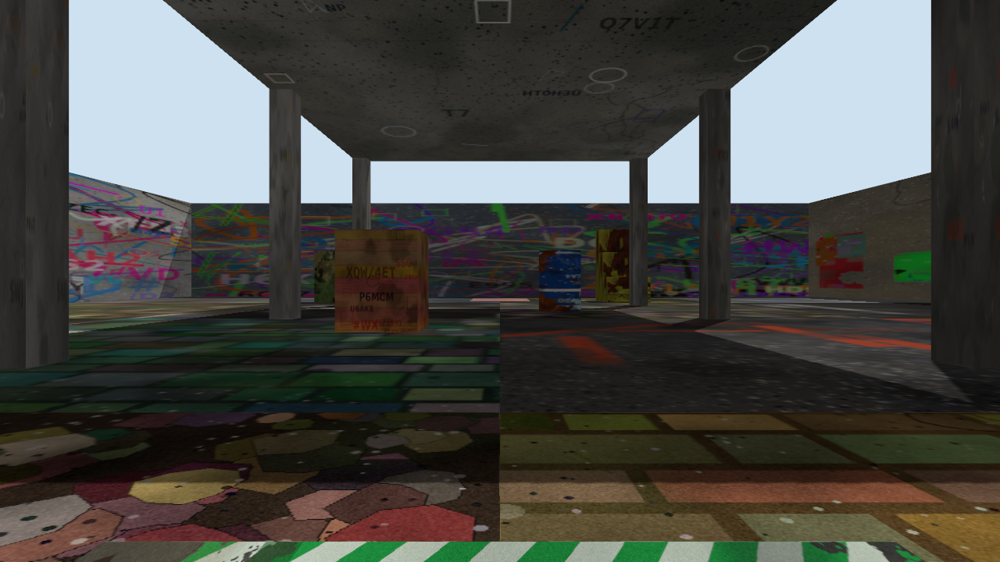
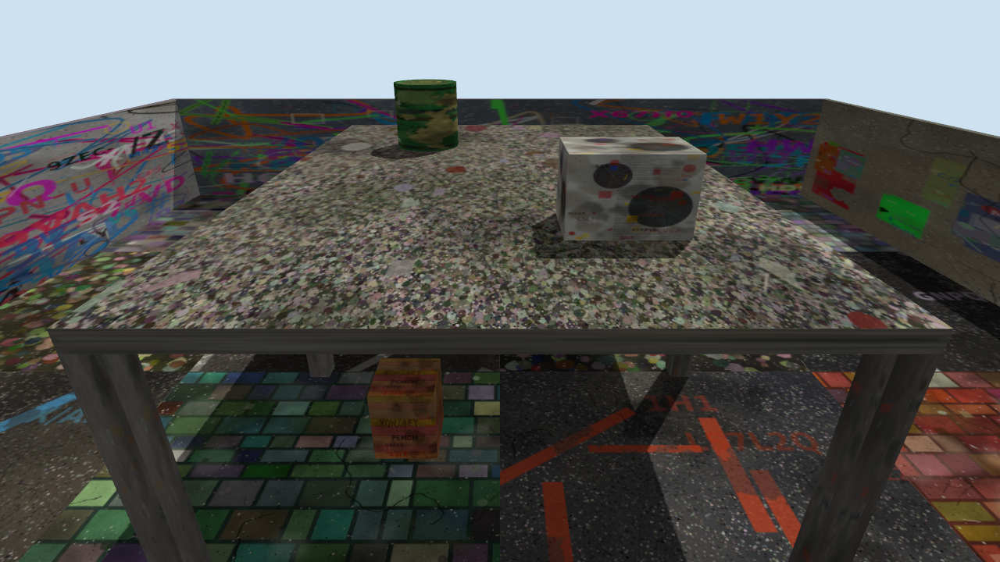

# couv_sim_world

Gazebo Harmonic (gz sim 8) world **`canopy_world`** for UAV–UGV cooperative RGB-D SLAM
(ROS 2 Humble, `ros-humble-ros-gzharmonic`).

A UAV and a UGV start together at (-7, 0). Under the flat canopy roof the UGV maps
obstacles the UAV cannot see; on top of the roof the UAV maps obstacles the UGV cannot see.
Four shared landmarks outside the canopy are seen by both and give the map-merging overlap.
Every surface carries its own generated, non-repeating texture so visual odometry has features
and loop closure is not fooled by repeated patterns.



| Top view | UGV start view (z 0.5 m) | UAV start view (z 5 m) |
|---|---|---|
|  |  |  |

`docs/view_gui.png` is a screenshot from the Gazebo GUI (textures load in the GUI as well).

## Build & run

```bash
cd ~/ros2_ws
colcon build --packages-select couv_sim_world
source install/setup.bash

ros2 launch couv_sim_world world.launch.py                 # server + GUI
ros2 launch couv_sim_world world.launch.py headless:=true  # server only (gz sim -s -r)
```

The launch file appends `share/couv_sim_world/models` to `GZ_SIM_RESOURCE_PATH` and starts
`ros_gz_sim/gz_sim.launch.py`. Sourcing the workspace also sets that path (environment hook),
so `gz sim $(ros2 pkg prefix couv_sim_world)/share/couv_sim_world/worlds/canopy_world.sdf` works too.

The world name is fixed to `canopy_world`, so ground-truth poses are available on
`/world/canopy_world/pose/info` (and `/world/canopy_world/dynamic_pose/info`) once robots are spawned.

## Coordinates

Units m, origin = map centre, z up, all models `<static>true</static>`.
Roof: underside z = 3.0, top z = 3.2. The table below is generated from `scripts/layout.py`.

<!-- LAYOUT_TABLE_BEGIN (generated by scripts/gen_world.py) -->
| Model (`model://`) | Description | Zone | Centre (x, y) [m] | Size [m] | z range [m] |
|---|---|---|---|---|---|
| `floor` | Floor (16 tiles) | structure | (0, 0) | 20 x 20, 16 tiles of 5 x 5 | 0 – 0 |
| `outer_walls` | Outer walls | structure | (0, 0) | walls at x, y = ±10, h 3, t 0.2 | 0 – 3 |
| `canopy` | Canopy (roof + 6 pillars) | structure | (0, 0) | roof 8 x 6 x 0.2; pillars 0.3 x 0.3 x 3 at x ∈ {-3.85, 0, 3.85}, y = ±2.85 | 0 – 3.2 |
| `crate_stack` | Crate stack | under roof (UGV only) | (-1.5, 1.2) | box 0.8 x 0.8 x 1 | 0 – 1 |
| `drum` | Drum | under roof (UGV only) | (1.8, -1) | cylinder r 0.35, h 1 | 0 – 1 |
| `ac_unit` | AC outdoor unit | on roof (UAV only) | (-2, -1.2) | box 0.8 x 1.2 x 0.8 | 3.2 – 4 |
| `water_tank` | Water tank | on roof (UAV only) | (2, 1.2) | cylinder r 0.5, h 1 | 3.2 – 4.2 |
| `lm_box` | Landmark A: tall box | shared landmark (both) | (-6, 3) | box 1 x 1 x 1.5 | 0 – 1.5 |
| `lm_cylinder` | Landmark B: column | shared landmark (both) | (-6, -3.5) | cylinder r 0.4, h 2 | 0 – 2 |
| `lm_lshape` | Landmark C: L-block | shared landmark (both) | (6, 3.5) | L-block (arm 0.6) 1.6 x 1.6 x 1.2 | 0 – 1.2 |
| `lm_stairs` | Landmark D: stairs | shared landmark (both) | (6, -3) | 3 steps 0.6/1.2/1.8 1.5 x 1 x 1.8 | 0 – 1.8 |
| `start_zone` | Start zone | floor marker (no collision) | (-7, 0) | box 2 x 1.5 x 0.004 | 0.001 – 0.005 |
| `goal_zone` | Goal zone | floor marker (no collision) | (7, 0) | box 2 x 1.5 x 0.004 | 0.001 – 0.005 |
<!-- LAYOUT_TABLE_END -->

### Start, route, altitude

- **Start**: UGV at **(-7, 0)** facing **+x** (yaw 0). The UAV takes off from on top of the UGV.
- **Goal**: (7, 0). Start/goal plates are 2 × 1.5 m, visual only (no collision).
- **Recommended UGV route** (waypoints, z = 0):
  (-7, 0) → (-4.5, 0) → (-1.5, -0.3) → (1.8, 0.4) → (4.5, 0) → (7, 0).
  It enters the canopy between the pillars at x = -3.85, passes **south of the crate stack**
  (≈ 1.0 m clearance) and **north of the drum** (≈ 1.0 m clearance), and leaves between the
  pillars at x = 3.85. Clearance to every pillar and landmark is ≥ 2.5 m.
- **Recommended UAV altitude: 5.0 m.** The highest rooftop object (water tank) tops out at
  z = 4.2 m, the outer walls at 3.0 m, so the clearance is 0.8 m. Keep ≥ 4.5 m when over the roof.

## Regenerating

All coordinates, sizes and texture styles live in **`scripts/layout.py`** only.
After editing it:

```bash
cd ~/ros2_ws/src/couv_sim_world
python3 scripts/gen_textures.py        # PNG textures (≈30 s; --models drum canopy for a subset, --scale 0.5 for smaller files)
python3 scripts/gen_world.py           # model.sdf/config, worlds/canopy_world.sdf, docs/layout.png, table above
python3 scripts/capture_views.py       # docs/view_{top,ugv,uav}.png (renders with ogre2, needs a display)
cd ~/ros2_ws && colcon build --packages-select couv_sim_world
```

Syntax check (`gz sdf` resolves `model://` via `SDF_PATH`, not `GZ_SIM_RESOURCE_PATH`):

```bash
SDF_PATH=$PWD/models gz sdf -k worlds/canopy_world.sdf
for f in models/*/model.sdf; do gz sdf -k $f; done
```

`gen_world.py` also checks that rooftop objects stay below the UAV altitude and that the UGV route
keeps clearance from obstacles, and fails if they don't.

Each texture has a fixed seed (so regeneration is reproducible); change a seed in `layout.py`
to get a different pattern. The generator refuses duplicate seeds.
Requirements: `python3-numpy`, `python3-pil`, `python3-matplotlib`.

### Textures

| Surface | Style |
|---|---|
| Floor tiles (16) | asphalt with worn road paint, pavers, cobbles — each with its own colours and seed |
| Outer walls (4) | graffiti (N, E), poster wall (S, W), 2048 × 1024 |
| Roof top / underside | gravel / stained concrete |
| Pillars (6) | concrete, each different |
| Crate stack, drum, AC unit, water tank | wood planks, rusty painted metal, fan grille panel, painted tank |
| Landmarks A–D | brick, mosaic, camouflage, rusty yellow paint |
| Start / goal | green / red hazard stripes |

Materials use `<pbr><metal><albedo_map>model://…</albedo_map>` plus a pale `<diffuse>` tint
of the texture's mean colour (gz multiplies diffuse with the albedo map, so a pale tint keeps the
texture's contrast while still giving a coloured fallback if the PNG cannot be found).

## Layout of the package

```
worlds/canopy_world.sdf          generated world
models/<name>/                   model.config, model.sdf, materials/textures/*.png
scripts/layout.py                single layout definition
scripts/gen_textures.py          texture generator (numpy + Pillow)
scripts/gen_world.py             SDF + layout.png + README table generator
scripts/capture_views.py         reference renders
launch/world.launch.py
docs/layout.png, docs/view_*.png
```

Note: the textures total ≈100 MB (38 PNGs of 1–3 MP of deliberate high-frequency noise).
Regenerate with `--scale 0.5` if you need a lighter package.
